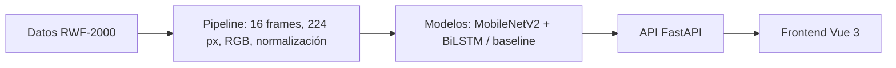

# Informe técnico: detector de comportamiento sospechoso en video

**Proyecto académico:** Tópicos y Programación Avanzada, UAGRM  
**Equipo:** Ariany, Lorgio, Diego y Grageda  
**Estado de la evaluación:** 1 de noviembre de 2026. Resultados de un subset ejecutado en CPU.

## 1. Problema y objetivo

La inseguridad en Bolivia motiva estudiar herramientas que ayuden a revisar grabaciones de vigilancia. Las cámaras pueden registrar un incidente, pero observar continuamente muchas transmisiones exige tiempo y atención humana. Este proyecto clasifica clips de video como **Normal** o **Sospechoso** para priorizar la revisión. El sistema es un prototipo académico de apoyo: una alerta no equivale a una confirmación de delito y la persona operadora conserva la decisión. Aunque el nombre del proyecto menciona forcejeos y asaltos, la evaluación cuantitativa disponible se refiere a la distinción **Fight/NonFight** de RWF-2000; no se midió una clase separada de asalto.

## 2. Datos y diseño experimental

El conjunto principal es [RWF-2000, de Cheng, Cai y Li (ICPR 2020)](https://arxiv.org/abs/1911.05913), formado por 2.000 clips de vigilancia de 5 segundos, 1.000 con pelea y 1.000 sin pelea. La copia usada por el equipo provino del [registro de Zenodo](https://zenodo.org/records/15687512), cuya licencia se registró en `data/README.md` como CC BY 4.0; este trabajo lo usa con fines académicos y cita a los autores. La estructura original comprobada es `train/Train_Fight` (800), `train/Train_NonFight` (800), `val/Val_Fight` (200) y `val/Val_NonFight` (200). No se publica ningún video dentro del repositorio.

El entrenamiento local en CPU tomó **400 clips balanceados**, 200 Fight y 200 NonFight. De 300 clips seleccionados en `train/`, la partición por video fuente dejó **259 para entrenamiento** y **41 para validación interna**. Otros **100 clips de `val/` original** se reservaron como test y no se usaron para escoger épocas. La semilla fue 42. El test contiene 50 casos de cada clase, como muestran las filas de ambas matrices de confusión. El script `scripts/train_local_cpu.py` guarda el mejor checkpoint según F1 macro de la validación interna y evalúa el test una vez al final. `resnet_lstm` todavía no cuenta con un JSON de test; su fila queda pendiente.

El EDA de `notebooks/02_eda_datasets.ipynb` encontró que los clips de RWF-2000 duran 5,0 s y tienen 30 fps, pero las resoluciones varían. Una regla basada solo en resolución separó las clases con aproximadamente 75 % de exactitud en la exploración; por tanto, una buena puntuación de un clasificador visual **no prueba por sí sola** que aprendió a reconocer una pelea. Los 2.000 clips provienen de cerca de 961 videos fuente según el prefijo del nombre. La separación por fuente evita que secuencias relacionadas caigan en entrenamiento y validación interna. Se deben examinar errores y rendimiento por resolución antes de cualquier uso fuera de la demo.

El equipo no extrajo grabaciones de cámaras ajenas. Es una decisión de minimización de datos y respeto a las personas grabadas. La [Ley boliviana 164](https://www.justicia.gob.bo/cms/files/LEY%20N%C2%BA%20164%20Gaceta%20Oficial_gs7rr7i4.pdf) contempla protección de datos personales e intimidad en su ámbito de telecomunicaciones y tecnologías de información; no se afirma aquí que por sí sola prohíba toda captura de video. Para un despliegue real haría falta revisar la base jurídica, permisos, retención, seguridad y normativa aplicable a la cámara concreta. En la demo, la API usa archivos temporales que elimina al terminar cada análisis; el historial del navegador conserva solo nombre, fecha y resultado.

## 3. Preprocesamiento

El código fuente está en `src/preprocessing/video_pipeline.py`; la API reutiliza `VideoPreprocessor(train=False)`. Sus seis etapas lógicas son:

1. **Lectura y muestreo temporal.** OpenCV abre el video o el tramo solicitado. `np.linspace` reparte 16 índices a lo largo del tramo para cubrir inicio, medio y final con un costo viable en CPU. Dieciséis es una elección de compromiso de cobertura y tiempo; los notebooks comparan cobertura/costo de 8, 16 y 32, no exactitud entre modelos entrenados con cada cantidad.
2. **Redimensionamiento y conversión de color.** Cada frame se lleva a 224 × 224 píxeles y de BGR a RGB. MobileNetV2 preentrenado recibe tres canales RGB en ese tamaño de entrada.
3. **Normalización.** Los píxeles se escalan y se normalizan con media `(0.485, 0.456, 0.406)` y desviación `(0.229, 0.224, 0.225)` de ImageNet, consistentes con los pesos preentrenados.
4. **Conversión a tensor.** El orden `(T, H, W, C)` pasa a `(T, C, H, W)`, con tipo `float32`, para que PyTorch y el backbone reciban `(16, 3, 224, 224)`.
5. **Aumento de datos, solo en entrenamiento.** El pipeline puede aplicar flip, recorte y jitter. La decisión aleatoria se toma **una vez por clip** y se aplica de forma coherente a sus 16 frames; transformaciones diferentes en cada imagen podrían crear cambios artificiales que la LSTM interpretaría como movimiento. En validación, test e inferencia se desactiva.
6. **Composición del pipeline.** `VideoPreprocessor` encadena las operaciones y devuelve el tensor que usan tanto el entrenamiento como la API. El backend no implementa una segunda versión del preprocesamiento; así se reduce el riesgo de diferencias entre evaluación e inferencia.

## 4. Arquitectura del modelo y entrenamiento

El modelo seleccionado, `mobilenet_lstm`, aplica MobileNetV2 con pesos de ImageNet a cada uno de los 16 frames. Su extractor convolucional queda congelado y en modo evaluación; un promedio global produce un vector de **1.280 características** por frame. La BiLSTM bidireccional tiene **128 unidades por dirección** y resume la secuencia en 256 valores. La cabeza final usa `Dropout(0.3) → Linear(256, 64) → ReLU → Linear(64, 2)`. La salida son logits para Normal y Sospechoso. Durante entrenamiento, `CrossEntropyLoss` recibe logits; durante inferencia se aplica softmax para obtener probabilidades.

El aprendizaje por transferencia permite entrenar la parte temporal y la cabeza con pocos clips y recursos de CPU, reutilizando características visuales de ImageNet. No garantiza que esas características capturen el contexto de violencia. Para comparar la contribución temporal se entrenó también `mobilenet_baseline`, que usa el mismo backbone y una cabeza sin BiLSTM. `resnet_lstm` está implementado como alternativa de backbone, pero su evaluación local aún está pendiente.

La corrida configuró máximo **5 épocas**, tasa de aprendizaje **1e-4**, **batch 4**, semilla **42**, optimizador Adam, scheduler que reduce la tasa cuando F1 macro se estanca y parada temprana con paciencia 2. El LSTM ejecutó **4 épocas** y seleccionó el checkpoint de la época 2; el baseline ejecutó **5 épocas** y seleccionó la época 3. Estas cifras están en los JSON de `artifacts/`. El tiempo de inferencia informado incluye la evaluación local en CPU y depende de la máquina.

## 5. Resultados medidos y análisis de errores

Los números siguientes proceden de `artifacts/metrics_mobilenet_lstm.json` y `artifacts/metrics_mobilenet_baseline.json`. Todos corresponden a los mismos 100 clips de test. `AP` es el área resumida por average precision de la curva precisión–recall; la clase positiva es Fight.

| Modelo | Accuracy | F1 macro | Recall Fight | Precisión Fight | AP | Matriz [[TN, FP], [FN, TP]] | ms/clip |
|---|---:|---:|---:|---:|---:|---|---:|
| mobilenet_lstm | 0,640 | 0,638 | **0,720** | 0,621 | 0,651 | [[28, 22], [14, 36]] | 594,3 |
| mobilenet_baseline | **0,660** | **0,659** | 0,620 | **0,674** | **0,684** | [[35, 15], [19, 31]] | **406,3** |
| resnet_lstm | **PENDIENTE** | **PENDIENTE** | **PENDIENTE** | **PENDIENTE** | **PENDIENTE** | **PENDIENTE** | **PENDIENTE** |

Para el LSTM, las filas de la matriz son la clase real y las columnas la predicción:

| Real / Predicción | Normal | Sospechoso |
|---|---:|---:|
| Normal | 28 (TN) | 22 (FP) |
| Sospechoso | 14 (FN) | 36 (TP) |

El LSTM recuperó 36 de 50 peleas, cinco más que el baseline, pero produjo 22 falsas alarmas, siete más que el baseline. El baseline ganó 2,2 puntos porcentuales de F1 macro y tardó cerca de 188 ms menos por clip. Se escoge **`mobilenet_lstm` para la demo académica** porque la prioridad declarada es reducir falsos negativos de Fight. Esta elección no representa una validación para operar una alarma de seguridad real. Un falso negativo podría dejar un incidente sin priorizar; un falso positivo consume atención humana y puede generar una intervención indebida. El umbral y la ventana temporal deben acordarse y probarse según el contexto.

Los JSON disponibles son **agregados**: contienen métricas y matriz, pero no rutas ni predicciones individuales del test. Por ello no es posible atribuir honestamente errores a tres videos concretos. Los tres casos de revisión requeridos quedan definidos de manera verificable:

1. **TODO — falso negativo 1:** exportar el identificador, etiqueta real, score Fight, resolución y una observación visual de un clip Fight predicho NonFight.
2. **TODO — falso negativo 2:** registrar un segundo Fight omitido, preferentemente con condiciones visuales distintas, y verificar si la pelea ocurre fuera de los 16 frames muestreados.
3. **TODO — falso positivo 1:** registrar un clip NonFight marcado Fight; comprobar si contiene juego, deporte de contacto, empujones o movimiento brusco sin pelea.

Hay **14 falsos negativos y 22 falsos positivos** del LSTM entre los que elegir esos ejemplos. Para completar la revisión, se necesita guardar `video_id`, `y_true`, `y_pred` y `score` del mismo test sin modificar el split ni recalcular un resultado distinto. El notebook `notebooks/03_model_comparison.ipynb` dibuja las matrices, curvas precisión–recall y la comparación de precisión/recall a partir de los JSON.

## 6. Arquitectura del sistema

En entrenamiento, el script de CPU toma el subset de RWF-2000, usa `VideoPreprocessor`, selecciona el checkpoint con validación interna y escribe los archivos `metrics_*.json`. En la demo, la persona sube un MP4 desde **Analizar** o varios desde **Lote**. FastAPI valida extensión, tamaño máximo de 100 MB y duración máxima de 2 minutos; guarda el archivo temporalmente, lo divide en tramos de 2 segundos y obtiene la probabilidad Fight de cada uno. Con el umbral inicial 0,5, una alerta global requiere más de 3 segundos consecutivos sobre el umbral, salvo que el tramo sospechoso cubra todo un video corto. La respuesta contiene veredicto, confianza, línea de tiempo, duración, modelo e identificador temporal. El frontend muestra el resultado, permite mover el umbral sin repetir la inferencia y puede pedir a `/preprocessing_demo` los 16 frames del último video. La pestaña **Métricas** consulta los JSON a través de `/metrics?model=...`; **Datos** resume el subset; **Historial** guarda localmente las últimas 20 predicciones sin almacenar videos.

## 7. Limitaciones y mitigaciones

La evaluación usa solo **100 clips de test** y entrenamiento en un subset de **400**, así que la diferencia de 0,022 en F1 macro podría cambiar con otra muestra. El modelo fue evaluado en clips del propio RWF-2000, no en cámaras bolivianas ni en grabaciones en vivo. Además, el dataset etiqueta Fight/NonFight; no mide asaltos de forma independiente. El paper original reporta resultados mayores con **otro método**, lo cual no fundamenta prometer un F1 de 0,78–0,85 para nuestro modelo al ampliar datos o usar GPU. Eso es una hipótesis que exige entrenamiento y test reproducibles.

Los movimientos de un niño jugando, un saludo físico o un deporte pueden parecerse a una pelea y generar falsos positivos. La API usa una ventana temporal mayor de 3 segundos para suprimir picos aislados; el umbral ajustable permite explorar sensibilidad, pero **no cambia el rendimiento medido del test** hasta que se vuelva a evaluar. Los 22 FP actuales muestran que las falsas alarmas siguen siendo importantes. Conviene revisar manualmente errores, reunir ejemplos difíciles con derechos de uso claros y medir por resolución, iluminación, tipo de escena y fuente. La decisión final siempre debe incluir revisión humana.

El EDA detectó un posible atajo de resolución. Por ello, antes de afirmar generalización hay que comparar con una línea base basada en metadatos, comprobar fuentes independientes y evaluar en datos externos autorizados. También falta el resultado de `resnet_lstm`: **TODO** entrenarlo y evaluarlo con el mismo split y actualizar la tabla, el notebook y la decisión si cambia el balance de errores.

## 8. Uso de asistentes de IA

Los cuatro integrantes usaron Claude Code y/o ChatGPT como apoyo para programar, redactar y revisar el proyecto. El equipo debe revisar cada cambio antes de incorporarlo, ejecutar las pruebas pertinentes y poder explicar el código que firma en sus commits. Los asistentes no realizaron mediciones sustitutas: las métricas publicadas aquí provienen de los JSON de ejecución. Esta declaración cubre la asistencia, no atribuye automáticamente a cada integrante una herramienta o fragmento específico que no haya confirmado.

## Referencias

- Cheng, M., Cai, K. y Li, M. (2020). [*RWF-2000: An Open Large Scale Video Database for Violence Detection*](https://arxiv.org/abs/1911.05913). ICPR 2020.
- [Registro RWF-2000 en Zenodo](https://zenodo.org/records/15687512).
- [Ley N.º 164 de Bolivia](https://www.justicia.gob.bo/cms/files/LEY%20N%C2%BA%20164%20Gaceta%20Oficial_gs7rr7i4.pdf).
- Evidencia interna: `data/README.md`, `scripts/train_local_cpu.py`, `src/preprocessing/video_pipeline.py`, `src/models/model.py` y `artifacts/metrics_*.json`.
