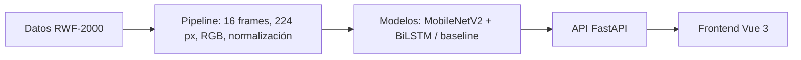

# Informe técnico: detector de comportamiento sospechoso en video

**Proyecto académico:** Tópicos y Programación Avanzada, UAGRM  
**Equipo:** Ariany, Lorgio, Diego y Grageda  
**Estado de la evaluación:** 1 de noviembre de 2026. Resultados de un subset ejecutado en CPU.

## 1. Problema y objetivo

La inseguridad en Bolivia motiva estudiar herramientas que ayuden a revisar grabaciones de vigilancia. Las cámaras pueden registrar un incidente, pero observar continuamente muchas transmisiones exige tiempo y atención humana. Este proyecto clasifica clips de video como **Normal** o **Sospechoso** para priorizar la revisión. El sistema es un prototipo académico de apoyo: una alerta no equivale a una confirmación de delito y la persona operadora conserva la decisión. Aunque el nombre del proyecto menciona forcejeos y asaltos, la evaluación cuantitativa disponible se refiere a la distinción **Fight/NonFight** de RWF-2000; no se midió una clase separada de asalto.

## 2. Datos y diseño experimental

El conjunto principal es [RWF-2000, de Cheng, Cai y Li (ICPR 2020)](https://arxiv.org/abs/1911.05913), formado por 2.000 clips de vigilancia de 5 segundos, 1.000 con pelea y 1.000 sin pelea. La copia usada por el equipo provino del [registro de Zenodo](https://zenodo.org/records/15687512), cuya licencia se registró en `data/README.md` como CC BY 4.0; este trabajo lo usa con fines académicos y cita a los autores. La estructura original comprobada es `train/Train_Fight` (800), `train/Train_NonFight` (800), `val/Val_Fight` (200) y `val/Val_NonFight` (200). No se publica ningún video dentro del repositorio.

El entrenamiento local en CPU tomó **400 clips balanceados**, 200 Fight y 200 NonFight. De 300 clips seleccionados en `train/`, la partición por video fuente dejó **259 para entrenamiento** y **41 para validación interna**. Otros **100 clips de `val/` original** se reservaron como test y no se usaron para escoger épocas. La semilla fue 42. Los clips salieron de una copia parcial de RWF-2000, con 1.348 clips en `train/` y 333 en `val/` según los logs de `artifacts/`; con otra copia, la misma semilla elige otros clips. El test contiene 50 casos de cada clase, como muestran las filas de ambas matrices de confusión. El script `scripts/train_local_cpu.py` guarda el mejor checkpoint según F1 macro de la validación interna y evalúa el test una vez al final. `resnet_lstm` todavía no cuenta con un JSON de test; su fila queda pendiente.

El EDA de `notebooks/02_eda_datasets.ipynb` encontró que los clips de RWF-2000 duran 5,0 s y tienen 30 fps, pero las resoluciones varían. Una regla basada solo en resolución separó las clases con aproximadamente 75 % de exactitud en la exploración; por tanto, una buena puntuación de un clasificador visual **no prueba por sí sola** que aprendió a reconocer una pelea. Los 2.000 clips provienen de cerca de 961 videos fuente según el prefijo del nombre. La separación por fuente evita que secuencias relacionadas caigan en entrenamiento y validación interna. Se deben examinar errores y rendimiento por resolución antes de cualquier uso fuera de la demo.

El equipo no extrajo grabaciones de cámaras ajenas. Es una decisión de minimización de datos y respeto a las personas grabadas. La [Ley boliviana 164](https://www.justicia.gob.bo/cms/files/LEY%20N%C2%BA%20164%20Gaceta%20Oficial_gs7rr7i4.pdf) contempla protección de datos personales e intimidad en su ámbito de telecomunicaciones y tecnologías de información; no se afirma aquí que por sí sola prohíba toda captura de video. Para un despliegue real haría falta revisar la base jurídica, permisos, retención, seguridad y normativa aplicable a la cámara concreta. En la demo, la API usa archivos temporales que elimina al terminar cada análisis; el historial del navegador conserva solo nombre, fecha y resultado.

## 3. Preprocesamiento

El modelo no recibe videos, recibe tensores. El módulo
`src/preprocessing/video_pipeline.py` convierte un video en un tensor de forma
`(16, 3, 224, 224)` con seis pasos. La clase `VideoPreprocessor` los encadena
y es la única implementación: el entrenamiento y la API la importan tal cual, de
modo que un video recibe exactamente el mismo tratamiento al entrenar y al
predecir.

| Paso | Función | Qué hace |
|---|---|---|
| 3.1 | `extract_frames` | Extrae 16 frames espaciados uniformemente con OpenCV |
| 3.2 | `resize_and_convert` | Redimensiona a 224×224 y pasa de BGR a RGB |
| 3.3 | `normalize_frames` | Escala a [0, 1] y normaliza con media y desvío de ImageNet |
| 3.4 | `augment_frames` | Variaciones aleatorias, solo al entrenar |
| 3.5 | `to_tensor` | Reordena a `(T, C, H, W)` |
| 3.6 | `VideoPreprocessor` | Encadena los pasos anteriores |

### 3.1 Extracción de frames

Se toman 16 frames con índices equiespaciados en lugar de todos: un clip de
5 s a 30 fps tiene 150 frames muy parecidos entre sí, y procesarlos todos
multiplicaría el costo sin aportar información nueva. Se eligió 16 por ser el
valor habitual en la literatura de clasificación de video (I3D, SlowFast,
CLIP-TSA).

Los notebooks de EDA (`notebooks/03_comparar_frames.ipynb`) respaldan esa
elección en **costo y cobertura temporal**, pero no en **exactitud**: medirla
exige entrenar con 8, 16 y 32 frames, y esa comparación sigue abierta.

La función acepta `start_sec` y `end_sec`. La API la usa para analizar un
video largo por tramos de 2 s con este mismo pipeline, sin reimplementar la
extracción.

### 3.2 Redimensionado y conversión de color

Cada frame pasa a 224×224, el tamaño de entrada de MobileNetV2 y ResNet50. Se
usa interpolación `INTER_AREA`, que produce menos aliasing que la bilineal al
reducir (los clips de RWF-2000 miden 320×240 o más).

OpenCV entrega los canales en orden BGR y las redes preentrenadas esperan RGB.
Sin la conversión, el rojo y el azul quedan invertidos y la red recibe colores
que nunca vio al entrenar.

### 3.3 Normalización

Los píxeles se dividen por 255 y luego se les resta la media y se divide por el
desvío de ImageNet, por canal:

- media = (0.485, 0.456, 0.406)
- desvío = (0.229, 0.224, 0.225)

Es obligatorio porque el backbone se preentrenó con esos valores. Con otra
escala, las activaciones internas no corresponden a lo que la red aprendió y las
predicciones dejan de tener sentido. Se calcula en `float32`: con `uint8`, la
resta de la media se desbordaría.

### 3.4 Data augmentation (solo en entrenamiento)

`augment_frames` sortea **una sola vez por clip** tres transformaciones y las
aplica igual a los 16 frames:

- **Flip horizontal**, con probabilidad 0.5: una pelea espejada sigue siendo
  una pelea.
- **Recorte aleatorio** del 80 al 100 % del área, reescalado al tamaño original:
  simula una cámara con otro encuadre sin recortar la acción.
- **Jitter leve de brillo y contraste** (factores entre 0.8 y 1.2): da
  robustez ante cámaras más oscuras o más claras. Se aplica sobre los píxeles
  en [0, 1], antes de volver a normalizar, para que "brillo ×1.2" signifique lo
  mismo en los tres canales.

Se sortea una sola vez por clip porque un flip o un recorte distinto en cada
frame rompería la coherencia temporal, que es justo lo que la LSTM necesita para
ver el movimiento. No se usan rotaciones ni flip vertical: las cámaras de
seguridad están derechas y rotar inventaría escenas imposibles. La función
acepta un `torch.Generator`, así que los tests pueden reproducir el resultado.

### 3.5 y 3.6 Tensorización y encadenado

`to_tensor` reordena los ejes a `(T, C, H, W)`, la forma que espera el modelo
CNN + LSTM. `VideoPreprocessor` aplica los pasos en este orden fijo: extraer,
redimensionar y convertir a RGB, normalizar, tensorizar y, si `train=True`,
augmentar. La augmentation va al final porque opera sobre el tensor ya
normalizado; en inferencia no se aplica.

Los tests (`tests/test_preprocessing.py`) cubren la forma y el rango de la
salida, la conversión BGR→RGB, la coherencia del augmentation entre frames, su
reproducibilidad y su funcionamiento en CPU y GPU.

## 4. Modelo

El problema se resuelve con **transfer learning**: en lugar de entrenar una red
para video desde cero (lo que exige días de GPU y millones de clips), se reutiliza
una red de imágenes ya entrenada y solo se entrena la parte que entiende el
movimiento.

### 4.1 Arquitectura

La clase `ViolenceDetector` (`src/models/model.py`) tiene tres bloques:

1. **MobileNetV2 preentrenado en ImageNet**, aplicado a cada frame. Extrae un
   vector de 1280 números por frame. Está **congelado**: sus pesos no se
   modifican.
2. **BiLSTM** (una capa, 128 unidades por dirección). Recibe la secuencia de 16
   vectores y produce 256 features que resumen el clip.
3. **Cabeza de clasificación**: `Dropout(0.3)` → `Linear(256→64)` → `ReLU` →
   `Linear(64→2)`. Devuelve dos logits, uno por clase `[Normal, Sospechoso]`; la
   probabilidad se obtiene con softmax en la API.

```
Clip (16, 3, 224, 224)
  → MobileNetV2 por frame (congelado)   → 16 vectores de 1280
  → BiLSTM (128 por dirección)          → 256 features
  → Dropout → Linear(256→64) → ReLU → Linear(64→2)
  → logits [Normal, Sospechoso]
```

### 4.2 Decisiones de diseño

- **Por qué MobileNetV2:** es liviano y apunta a correr en una laptop sin GPU.
  La hipótesis es que un backbone más pesado como ResNet50 gana poca exactitud
  a costa de mucho más tiempo de inferencia; la comparación de la sección 4.3
  la confirma o la desmiente.
- **Por qué congelar el backbone:** con pocos datos y pocos días, reentrenar
  toda la red sobreajusta. Además, el backbone se mantiene en modo `eval()`
  durante el entrenamiento: sus capas BatchNorm actualizarían sus estadísticas en
  cada pasada en modo `train` aunque los pesos estén congelados, y eso lo
  alejaría de ImageNet.
- **Por qué una LSTM:** un frame suelto de una pelea puede parecer un abrazo; el
  movimiento solo se ve mirando varios frames juntos.
- **Por qué bidireccional:** el modelo entiende qué pasó antes y después de cada
  momento.
- **Qué se le pasa al clasificador:** el estado final de la LSTM en las dos
  direcciones (`h_n`), no la salida del último paso. En ese último paso, la
  dirección hacia atrás solo vio un frame, así que resumiría casi nada del clip.

### 4.3 Variantes y entrenamiento ejecutado

Para comparar la contribución temporal se entrenó `mobilenet_baseline` con el mismo backbone y una cabeza sin BiLSTM. `resnet_lstm` está implementado como alternativa de backbone, pero su evaluación local sigue pendiente. Las métricas disponibles de las dos variantes MobileNet se comparan en la sección 5.

La corrida local configuró máximo **5 épocas**, tasa de aprendizaje **1e-4**, **batch 4**, semilla **42**, optimizador Adam, scheduler que reduce la tasa cuando F1 macro se estanca y parada temprana con paciencia 2. El LSTM ejecutó **4 épocas** y seleccionó el checkpoint de la época 2; el baseline ejecutó **5 épocas** y seleccionó la época 3. Estas cifras proceden de los JSON de `artifacts/`. El tiempo de inferencia se midió en CPU y depende de la máquina.

## 5. Resultados medidos y análisis de errores

Los números siguientes proceden de `artifacts/metrics_mobilenet_lstm.json` y `artifacts/metrics_mobilenet_baseline.json`. Todos corresponden a los mismos 100 clips de test. `AP` es el área resumida por average precision de la curva precisión–recall; la clase positiva es Fight.

| Modelo | Accuracy | F1 macro | Recall Fight | Precisión Fight | AP | Matriz [[TN, FP], [FN, TP]] | ms/clip |
|---|---:|---:|---:|---:|---:|---|---:|
| mobilenet_lstm | 0,640 | 0,638 | **0,720** | 0,621 | 0,651 | [[28, 22], [14, 36]] | 594,3 |
| mobilenet_baseline | **0,660** | **0,659** | 0,620 | **0,674** | **0,684** | [[35, 15], [19, 31]] | **406,3** |
| resnet_lstm | **PENDIENTE** | **PENDIENTE** | **PENDIENTE** | **PENDIENTE** | **PENDIENTE** | **PENDIENTE** | **PENDIENTE** |

Para el LSTM, las filas de la matriz son la clase real y las columnas la predicción:

| Real / Predicción | Normal | Sospechoso |
|---|---:|---:|
| Normal | 28 (TN) | 22 (FP) |
| Sospechoso | 14 (FN) | 36 (TP) |

El LSTM recuperó 36 de 50 peleas, cinco más que el baseline, pero produjo 22 falsas alarmas, siete más que el baseline. El baseline ganó 2,2 puntos porcentuales de F1 macro y tardó cerca de 188 ms menos por clip. Se escoge **`mobilenet_lstm` para la demo académica** porque la prioridad declarada es reducir falsos negativos de Fight. Esta elección no representa una validación para operar una alarma de seguridad real. Un falso negativo podría dejar un incidente sin priorizar; un falso positivo consume atención humana y puede generar una intervención indebida. El umbral y la ventana temporal deben acordarse y probarse según el contexto.

Los JSON disponibles son **agregados**: contienen métricas y matriz, pero no rutas ni predicciones individuales del test. Por ello no es posible atribuir honestamente errores a tres videos concretos. Los tres casos de revisión requeridos quedan definidos de manera verificable:

1. **TODO — falso negativo 1:** exportar el identificador, etiqueta real, score Fight, resolución y una observación visual de un clip Fight predicho NonFight.
2. **TODO — falso negativo 2:** registrar un segundo Fight omitido, preferentemente con condiciones visuales distintas, y verificar si la pelea ocurre fuera de los 16 frames muestreados.
3. **TODO — falso positivo 1:** registrar un clip NonFight marcado Fight; comprobar si contiene juego, deporte de contacto, empujones o movimiento brusco sin pelea.

Hay **14 falsos negativos y 22 falsos positivos** del LSTM entre los que elegir esos ejemplos. Para completar la revisión, se necesita guardar `video_id`, `y_true`, `y_pred` y `score` del mismo test sin modificar el split ni recalcular un resultado distinto. El notebook `notebooks/03_model_comparison.ipynb` dibuja las matrices, curvas precisión–recall y la comparación de precisión/recall a partir de los JSON.

## 6. Arquitectura del sistema



En entrenamiento, el script de CPU toma el subset de RWF-2000, usa `VideoPreprocessor`, selecciona el checkpoint con validación interna y escribe los archivos `metrics_*.json`. En la demo, la persona sube un MP4 desde **Analizar** o varios desde **Lote**. FastAPI valida extensión, tamaño máximo de 100 MB y duración máxima de 2 minutos; guarda el archivo temporalmente, lo divide en tramos de 2 segundos y obtiene la probabilidad Fight de cada uno. Con el umbral inicial 0,5, una alerta global requiere más de 3 segundos consecutivos sobre el umbral, salvo que el tramo sospechoso cubra todo un video corto. La respuesta contiene veredicto, confianza, línea de tiempo, duración, modelo e identificador temporal. El frontend muestra el resultado, permite mover el umbral sin repetir la inferencia y puede pedir a `/preprocessing_demo` los 16 frames del último video. La pestaña **Métricas** consulta los JSON a través de `/metrics?model=...`; **Datos** resume el subset; **Historial** guarda localmente las últimas 20 predicciones sin almacenar videos.

## 7. Limitaciones y mitigaciones

La evaluación usa solo **100 clips de test** y entrenamiento en un subset de **400**, así que la diferencia de 0,022 en F1 macro podría cambiar con otra muestra. El modelo fue evaluado en clips del propio RWF-2000, no en cámaras bolivianas ni en grabaciones en vivo. Además, el dataset etiqueta Fight/NonFight; no mide asaltos de forma independiente. El paper original reporta resultados mayores con **otro método**, lo cual no fundamenta prometer un F1 de 0,78–0,85 para nuestro modelo al ampliar datos o usar GPU. Eso es una hipótesis que exige entrenamiento y test reproducibles.

Los movimientos de un niño jugando, un saludo físico o un deporte pueden parecerse a una pelea y generar falsos positivos. La API usa una ventana temporal mayor de 3 segundos para suprimir picos aislados; el umbral ajustable permite explorar sensibilidad, pero **no cambia el rendimiento medido del test** hasta que se vuelva a evaluar. Los 22 FP actuales muestran que las falsas alarmas siguen siendo importantes. Conviene revisar manualmente errores, reunir ejemplos difíciles con derechos de uso claros y medir por resolución, iluminación, tipo de escena y fuente. La decisión final siempre debe incluir revisión humana.

El EDA detectó un posible atajo de resolución. Por ello, antes de afirmar generalización hay que comparar con una línea base basada en metadatos, comprobar fuentes independientes y evaluar en datos externos autorizados. También falta el resultado de `resnet_lstm`: **TODO** entrenarlo y evaluarlo con el mismo split y actualizar la tabla, el notebook y la decisión si cambia el balance de errores.

## 8. Uso de asistentes de IA

Los cuatro integrantes usaron Claude Code y/o ChatGPT como apoyo para programar, redactar y revisar el proyecto. El equipo debe revisar cada cambio antes de incorporarlo, ejecutar las pruebas pertinentes y poder explicar el código que firma en sus commits. Los asistentes no realizaron mediciones sustitutas: las métricas publicadas aquí provienen de los JSON de ejecución. Esta declaración cubre la asistencia, no atribuye automáticamente a cada integrante una herramienta o fragmento específico que no haya confirmado.

## Referencias

- Cheng, M., Cai, K. y Li, M. (2020). [*RWF-2000: An Open Large Scale Video Database for Violence Detection*](https://arxiv.org/abs/1911.05913). ICPR 2020.
- [Registro RWF-2000 en Zenodo](https://zenodo.org/records/15687512).
- [Ley N.º 164 de Bolivia](https://www.justicia.gob.bo/cms/files/LEY%20N%C2%BA%20164%20Gaceta%20Oficial_gs7rr7i4.pdf).
- Evidencia interna: `data/README.md`, `scripts/train_local_cpu.py`, `src/preprocessing/video_pipeline.py`, `src/models/model.py` y `artifacts/metrics_*.json`.
